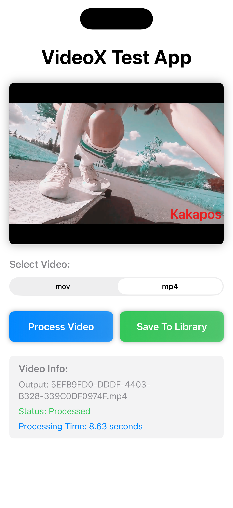

# Kakapos



[](https://cocoapods.org/pods/Kakapos)
[](https://cocoapods.org/pods/Harbeth) 


---

## 📖 Overview

**Kakapos** is a media orchestration engine for Apple platforms. It organizes local assets, player frames, camera frames, images, recordings, and timeline clips into a predictable media pipeline, then passes each frame through pluggable `FrameProcessor` objects.

To keep adoption lightweight, the public surface is grouped into four small boards: **Export**, **Preview**, **Record**, and **Timeline**. `KakaposSurface` is the primary public entry layer for all four boards.

Kakapos is not a filter-kernel library. It owns media lifecycle, frame sourcing, preview routing, recording, offline export, and timeline composition. When paired with [Harbeth](https://github.com/yangKJ/Harbeth), Kakapos handles the media engine layer while Harbeth handles high-quality GPU rendering for each frame.

At the top level, Kakapos can also be understood as three public engines over one shared core: **Video Engine**, **Camera Engine**, and **Timeline Engine**. `Media Core` provides the shared frame, processor, source, sink, and pipeline contracts.

### Architecture boundaries

Kakapos is an independent media foundation. Its package currently has no external SwiftPM dependency; its products compose MediaCore, Video, Camera, and Timeline internally. Rendering backends are injected by consumers through `FrameProcessor` rather than imported into the media engine.

The Harbeth family must not depend on Kakapos. Applications may use both image and media capabilities and own the adapter between them. If reusable higher-level media workflows are needed later, they can live in a separate `KakaposPackage` with capability-specific targets. That package is a future direction: it is not created or required by the current architecture, and no empty target is introduced in anticipation of it.

The current products and dependency declarations are defined by `Package.swift`. Core media lifecycle stays here; app branding, commercial policies, and user completion semantics stay in each consumer. Source/contract tests and builds remain distinct from permission, device, audiovisual-sync, and long-session runtime acceptance.

### ✨ Key Features

- **Processor-neutral frame pipeline**: Connect any processor that can transform `CVPixelBuffer`, `CMSampleBuffer`, or `MTLTexture` through `FrameProcessor`.
- **Pluggable render integration**: Keep rendering frameworks in the app layer and inject them through `FrameProcessor`; the example app demonstrates a Harbeth adapter.
- **Media sources**: Build pipelines from assets, player frames, camera frames, and image-backed timeline layers.
- **Media sinks**: Route processed frames to preview callbacks, recorders, offline exporters, or custom pixel-buffer consumers.
- **Export instruction layer**: `VideoX`, `Provider`, `Instruction`, `FilterInstruction`, `RotateInstruction`, and `WatermarkInstruction` are part of the Export board.
- **Timeline foundation**: Compose clip, image, audio, effect, group, transition, and keyframe-driven media models.

### Public Engines

Kakapos keeps a small board surface for day-to-day use, while the engine view explains the larger responsibility boundaries.

- **Video Engine**: asset input, player-frame preview, offline export, reader/writer export, and export instructions.
- **Camera Engine**: realtime camera capture, processed preview, device control, multi-segment recording, advanced outputs, and session lifecycle.
- **Timeline Engine**: timeline layers, groups, keyframes, transitions, audio mix, and timeline export.
- **Media Core**: shared `MediaFrame`, `FrameMetadata`, `FrameProcessor`, `MediaSource`, `MediaSink`, and `MediaPipeline` contracts.

### Platform Availability

| Distribution | Declared minimums | Notes |
| --- | --- | --- |
| Swift Package Manager | iOS 13, tvOS 12, watchOS 5, macOS 12 | Media Core, Video, and Timeline are the portable engine layers. Platform SDK availability still determines which AVFoundation features can run. |
| CocoaPods | iOS 13, macOS 12 | The podspec does not currently declare tvOS or watchOS deployment targets. |
| Camera capture | iOS / iPadOS | Camera hardware, microphone, permissions, depth, portrait matte, multicam, and AR capabilities are runtime-gated. |

Build success is not a substitute for device validation. Camera permissions, interruption recovery, orientation, HDR, audio/video sync, and long-recording memory behavior should be verified on the target devices.

### Lightweight Boards

Kakapos stays easier to adopt when the public surface is used in four small boards instead of one large API surface.
`KakaposSurface` is the recommended starting point for new code.
For code that only needs the recommended startup path, `KakaposSurface.starterBoards` gives the four boards in order.

Start with the smallest entry points:

- **Export**: `VideoX`, `ReaderWriterExportJob`
- **Preview**: `PreviewPipeline`, `PlayerFrameSource`, `PreviewSink`
- **Record**: `CameraEngine`, `RecordingPipeline`, `CameraSource`
- **Timeline**: `TimelinePipeline`, `TimelineComposition`

`RecorderSink.recordingCadence`提供有界录制摘要，并随`RecordedClip.recordingCadence`交付。摘要按成功写入的规范化PTS累计帧数、最大间隔、有效帧率、非单调计数、录制器明确丢弃的音视频及音画起止偏移；暂停先由录制时钟处理。可变帧率不自动判错，未知末帧时长返回nil尾部偏移；这些数据不代表传感器到显示的端到端帧龄，也不包含未到达录制器的所有上游丢帧。

Recorded clips are also first-class bridge inputs. After camera recording finishes, `RecordedClip` can be sent back into preview, timeline, and export without rebuilding the media wiring by hand.

The fuller surface stays available behind each board:

- **Export**: `VideoX`, `Provider`, `Instruction`, `FilterInstruction`, `RotateInstruction`, `WatermarkInstruction`, `ReaderWriterExportJob`
- **Preview**: `PlayerFrameSource`, `PreviewSink`, `MediaPipeline`, `MediaProcessorChain`
- **Record**: `CameraEngine`, `RecordingPipeline`, `CameraSource`, `CameraDeviceController`, `CameraPreviewController`, `CameraRecordingController`, `RecorderSink`, `RecordingSession`, `CameraAdvancedOutput`
- **Timeline**: `TimelineComposition`, `ClipLayer`, `ImageLayer`, `AudioLayer`, `EffectLayer`, `GroupLayer`, `Transition`, `KeyframeAnimation`

You can inspect the board catalog directly in code through `KakaposCapabilityCatalog.boards` when you want a compact view of the surface and its starter types.
`KakaposCapabilityCatalog.starterBoards` and `KakaposSurface.starterBoards` expose the same ordered starter path when you want the narrowest read-only entry list.

The board entry points above are the recommended path for new code.

### Camera Engine Highlights


显式 HLG 采集使用 `CameraVideoConfiguration(codec: .hevc, colorPolicy: .hdrHLG)`。
只有设备实际支持请求尺寸、帧率和 HLG 色彩空间时才启动；不静默降低分辨率或回退 SDR。
`RecordingPipeline` 继承相机的 HDR 交付合同；自定义处理器必须交回真实 P010 HLG/PQ 像素。
渲染框架由消费者 adapter 注入，Kakapos 不导入渲染内核。默认 `.sourceCompatible` 保留现有 SDR 用法。


- `CameraEngine`: top-level camera orchestration entry that assembles source, preview, recording, and processor routing.
- `CameraEngine` is the lifecycle owner when processed preview and recording share one `CameraSource`; both branches receive frames without competing to start or stop the capture session.
- `CameraSource`: video, audio, photo, metadata-object, depth, and portrait-matte capture output.
- `CameraDeviceController`: focus, exposure, white balance, zoom, torch, flash, frame-rate, and format control.
- `CameraPreviewController`: raw preview-layer mode and processed preview mode through `FrameProcessor`.
- `CameraRecordingController`: recorder orchestration over `RecorderSink` and `RecordingSession`.

`RecorderSink.Configuration.includesVideo` 默认为 `true`。独立音频副轨可显式使用
`RecorderSink(outputURL: url, fileType: .m4a, configuration: .init(includesVideo: false, includesAudio: true))`，
无需等待视频首帧。视频与音频分别维护单调时间戳，同一时刻的两路数据不会互相增加时长。
编码器视频输入未就绪时报告丢帧；音频输入背压显式返回错误，不调用未就绪的写入 API。

- `CameraAdvancedOutput`: metadata, depth, portrait matte, AR frame, and multicam event fan-out.

### 🔧 How It Works

Kakapos uses a `source -> processor chain -> sink` model:

```swift
let source = PlayerFrameSource(player: player)
let processor = MyFrameProcessor()
let sink = PixelBufferSink { frame in
    // Preview, inspect, record, or forward the processed frame.
}

let pipeline = MediaPipeline(source: source, processors: [processor], sinks: [sink])
pipeline.start()
```

`MediaPipeline` keeps lossless/unbounded delivery as the default for offline work. Real-time callers can opt into an explicit bounded policy:

```swift
let previewPipeline = MediaPipeline(
    source: source,
    processors: [processor],
    sinks: [previewSink],
    deliveryPolicy: .latestOnly
)

let recordingPipeline = MediaPipeline(
    source: source,
    processors: [processor],
    sinks: [recorderSink],
    deliveryPolicy: .boundedDropNewest(maximumInFlightFrames: 6)
)
```

`PreviewPipeline` uses latest-only delivery, while `RecordingPipeline` uses a bounded real-time queue. `droppedSourceFrameCount` exposes pressure without changing offline pipelines into lossy pipelines.

`MediaPipeline.stop(completion:)` closes admission, drains accepted frames, finishes sinks, and delivers one terminal result per registered callback on the main queue. Its state is `finishing` until all sinks have finished successfully. Cancellation rejects late processor results and propagates to cancellable processing operations. Processor work runs on the processing queue; configuration changes take effect on subsequent frames.

`AssetSource` uses completion acknowledgements to bound lossless delivery to two outstanding samples by default, plus one video and one audio lookahead sample. Its source snapshot exposes outstanding and peak counts. Old source delegates remain compatible; their default acknowledgement means their synchronous callback has returned.

Camera processing subscribers use a separate delivery route from public main-thread callbacks. Video and audio have independent ingress budgets (6 video frames and 12 audio samples). Recording bypasses video processors for audio, reports audio overflow as a failure, and waits for accepted video processing before finishing the writer.

A `MediaPipeline` instance is single-run. It can pause and resume while running, but `finished`, `cancelled`, and `failed` are terminal states. Create a new pipeline, processor chain, and sinks for a new run; a restartable source does not make the whole pipeline reusable.

`CameraSource` also applies bounded drop-newest admission before it creates any asynchronous frame delivery. The default ingress capacity is 6 frames, configurable through `CameraSourceConfiguration.maximumInFlightFrameCount`. Inspect `frameIngressSnapshot` for the current/high-water count and separate dropped video/audio totals.

For reusable real-time routing, build a chain once and attach it anywhere a `MediaSink` is accepted:

```swift
let previewChain = MediaProcessorChain(
    processors: [MyFrameProcessor()],
    sinks: [
        PreviewSink { image, metadata in
            // update UI
        },
        RecorderSink(outputURL: outputURL)
    ]
)
```

For offline export users, the recommended public path still starts at `KakaposSurface`:

Reader/writer export accepts an optional `videoFrameProcessingTimeout` watchdog. `performanceSnapshot` reports library-side sample, processor, backpressure, finishing, and terminal timing, and freezes at terminal completion. These metrics do not measure GPU execution, process memory peaks, or device-level HDR behavior.

---

### Export Instructions

- Create the video exporter provider.

```
let exporter = KakaposSurface.export(provider: .init(with: inputURL))

Or

let exporter = KakaposSurface.export(provider: .init(with: ``AVAsset``))
```

- Create a filter instruction and inject an app-owned renderer.

```
let processor = MyFrameProcessor()
let filtering = FilterInstruction(processor: processor)
```

`MyFrameProcessor` is owned by the consuming app and can wrap Harbeth, Metal, Core Image, or another renderer. The example app includes `HarbethExampleFrameProcessor` as a reference integration; Kakapos Core does not import Harbeth.

Recorded output can be promoted into downstream boards directly:

```swift
cameraEngine.stopRecording { result in
    guard case .success(let clip) = result else { return }

    let preview = clip.makePreviewPipeline { image, metadata in
        // inspect the recorded result
    }

    let exportTask = clip.makeExportTask(outputURL: outputURL)
    preview?.start()
    exportTask?.start { _ in }
}
```

The example app mirrors the same flow in the `Record` tab. After a capture finishes, the recorded clip can be sent back into:

- `KakaposSurface.preview(recordedClip:)`
- `KakaposSurface.timeline(recordedClip:)`
- `KakaposSurface.timelineExportTask(recordedClip:outputURL:)`

Or bridge the new processor API into the old instruction API:

```swift
let processor = MyFrameProcessor()
let filtering = FilterInstruction(processor: processor)
```

- Create a watermark instruction.

```
let textWatermark = WatermarkInstruction(
    type: .text("Kakapos", font: .boldSystemFont(ofSize: 120), color: .red),
    position: .bottomRight,
    margin: 20,
    opacity: 0.8,
)
```

The native watermark processor has an explicit SDR contract: it rejects HLG/PQ input, renders to BGRA sRGB, and publishes matching Rec.709 primaries with an sRGB transfer function. Reader/writer export returns rendering failures. The legacy video-composition callback falls back to the source frame because its API has no error channel; configure `renderingFailureHandler` before export to observe that compatibility fallback on the rendering queue.

- Create a rotate instruction.

```
let rotateInstruction = RotateInstruction(rotationAngle: selectedRotation)
```

- Convert video and then convert buffer.

```
let exporter = KakaposSurface.export(provider: provider)

/// Export the video.
/// - Parameters:
///   - options: Setup other parameters about export video.
///   - instructions: Operation procedure.
///   - complete: The conversion is complete, including success or failure.
exporter.export(options: [
    .OptimizeForNetworkUse: true,
    .ExportSessionTimeRange: TimeRangeType.range(5...28.0),
], instructions: [filtering, textWatermark, rotateInstruction], complete: { res in
    // do somthing..
}, progress: { pro in
    // progressing..
})
```

### Custom Instruction

You can create your own custom instructions by following these steps:

1. **Create a calss that conforms to the `InstructionProtocol` & `Instruction`**
2. **Use your custom instruction**


### Example: Create a Brightness Adjustment Instruction

```swift
public class BrightnessInstruction: CompositionInstruction {
    public let timeRange: CMTimeRange
    public let brightness: Float
    
    public init(brightness: Float, timeRange: CMTimeRange = .init(start: .zero, duration: .positiveInfinity)) {
        self.brightness = brightness
        self.timeRange = timeRange
    }
    
    public required init?(coder aDecoder: NSCoder) {
        fatalError("init(coder:) has not been implemented")
    }
    
    public func operationPixelBuffer(_ buffer: CVPixelBuffer, block: @escaping BufferBlock, for request: AVAsynchronousVideoCompositionRequest) {
        if let brightnessBuffer = processBrightness(buffer) {
            block(brightnessBuffer) 
        }
    }
    
    func processBrightness(_ pixelBuffer: CVPixelBuffer) -> CVPixelBuffer? {
        // Implement brightness adjustment logic
        // This could use CoreImage, Harbeth, or other frameworks
        return pixelBuffer
    }
}
```

By following this pattern, you can create any custom video processing instructions you need.
 
Custom instructions remain useful for export-only workflows. For new media engine work, prefer `FrameProcessor`, `MediaSource`, `MediaSink`, and `MediaPipeline`.

### Timeline Foundation

```swift
let timeline = TimelineComposition(renderSize: CGSize(width: 720, height: 1280))
timeline.addLayer(ClipLayer(asset: firstAsset, timeRange: CMTimeRange(start: .zero, duration: firstDuration)))
timeline.addLayer(ClipLayer(asset: secondAsset, timeRange: CMTimeRange(start: firstDuration, duration: secondDuration)))

let compiled = timeline.compile()
guard compiled.isValid else {
    print(compiled.diagnostics)
    return
}
let item = AVPlayerItem(asset: compiled.composition)
item.videoComposition = compiled.videoComposition
item.audioMix = compiled.audioMix
```

Track insertion failures are retained in `CompiledTimelineComposition.diagnostics`. Export jobs created from an invalid compiled timeline fail closed instead of silently exporting a partial composition.

### Timeline effects and HDR contracts

Call `TimelinePipeline.compile(exportProfile:)` explicitly for an edit snapshot and reuse the compiled result for preview and export. Effect layers apply to the composed frame in `[start, end)`, ordered by ascending layer level and insertion order. Intensity and keyframes are evaluated in composition time; intermediate intensities blend in linear light. `EffectSource(makeProcessor:)` creates processors for independent runs. A nonempty explicit export processor array continues to override timeline effects.

`VideoExportColorPolicy.hdrHLG` and `.hdrPQ` request HEVC Main10 and real 10-bit pixel buffers. HDR processors must explicitly declare the requested dynamic range and preserve color information. Unsupported codecs, missing output buffers, and HDR-to-SDR processor output fail explicitly. SDR delivery remains explicit through `.standardBT709` and the existing normalization processor.

On supported iOS devices, `CompiledTimelineComposition.makePreviewSession(surface:)` routes the same effect plan through the HDR-capable Metal surface. Displays without EDR use a display-only mapping. The CGImage callback preview remains an SDR interface. The HDR contract covers HLG/PQ, not Dolby Vision dynamic metadata preservation.

The Lab includes an HDR and time-range export validation page. Build/test results, decoded output validation, device playback, and performance comparisons are separate acceptance evidence.

### Commercial Boundary

The open-source Kakapos package provides the media engine foundation: processor-neutral frame routing, offline export compatibility, processor integration contracts, player frame sourcing, recording primitives, and timeline models.

Private Kakapos Pro / Visual Engine work can extend this base with production camera UX, template systems, advanced timeline effects, performance tuning, private processor adapters, and complete starter kits.

### CocoaPods

- If you want to import [**media engine**](https://github.com/yangKJ/Kakapos) module, you need in your Podfile:

```
pod 'Kakapos'
```

- If you want to import [**render engine**](https://github.com/yangKJ/Harbeth) module, you need in your Podfile:

```
pod 'Harbeth'
```

Harbeth is optional. The consuming app owns the adapter that conforms Harbeth or another renderer to Kakapos `FrameProcessor`.

### Swift Package Manager

[Swift Package Manager](https://swift.org/package-manager/) is a tool for managing the distribution of Swift code. It’s integrated with the Swift build system to automate the process of downloading, compiling, and linking dependencies.

> Kakapos requires the Xcode 16+ / Swift 6 toolchain and currently compiles in Swift 5 language mode while its concurrency contracts are migrated. The library supports iOS 13+, while the example app currently targets iOS 16.6.

To integrate Kakapos into your Xcode project using Swift Package Manager, add it to the dependencies value of your `Package.swift`:

```swift
dependencies: [
    .package(url: "https://github.com/yangKJ/Kakapos.git", from: "1.1.0"),
]
```

Link only the products your app owns:

- `KakaposMediaCore`: frame, processor, source, sink, and pipeline contracts.
- `KakaposVideo`: processed preview, asset sources, transcode, export, and artifact validation.
- `KakaposTimeline`: composition, keyframes, transitions, and timeline export.
- `KakaposCamera`: capture, processed camera preview, and recording. Camera produces `RecordedClip`; downstream Video or Timeline modules consume it.
- `Kakapos`: umbrella product for demos or apps that intentionally need every engine.

For example, an app that only rescues existing videos should link and import `KakaposMediaCore` plus `KakaposVideo`; it should not pull in Camera or Timeline.

### Migration Note

The next distribution baseline raises the library minimum from iOS 12 to iOS 13 and removes the conditional Core-owned `HarbethFrameProcessor` and `.kaka.filtering` APIs. Move that bridge into the consuming app (the example app provides `HarbethExampleFrameProcessor`) and inject it through `FrameProcessor`. Treat this as a breaking distribution change when choosing the next release version.

### Remarks

> The general process is almost like this, the Demo is also written in great detail, you can check it out for yourself.🎷
>
> [**KakaposDemo**](https://github.com/yangKJ/Kakapos)
>
> Tip: If you find it helpful, please help me with a star. If you have any questions or needs, you can also issue.
>
> Thanks.🎇

### About the author
- 🎷 **E-mail address: [yangkj310@gmail.com](yangkj310@gmail.com) 🎷**
- 🎸 **GitHub address: [yangKJ](https://github.com/yangKJ) 🎸**

Buy me a coffee or support me on [GitHub](https://github.com/sponsors/yangKJ?frequency=one-time&sponsor=yangKJ).

<a href="https://www.buymeacoffee.com/yangkj3102">

</a>

Alipay or WeChat. Thanks.

<p align="left">


</p>

-----

### License
Kakapos is available under the [MIT](LICENSE) license. See the [LICENSE](LICENSE) file for more info.

-----

### 相机采集像素格式偏好

`CameraVideoConfiguration.preferredPixelFormats` 允许消费者按顺序请求设备实际支持的采集格式，例如优先使用双平面 YUV 以减少输入带宽。空列表保留既有默认格式；显式 HDR 仍强制所需的 10-bit 格式，不被 SDR 偏好覆盖。`RecorderSink` 按实际输入缓冲区像素类型配置写入适配器，避免 NV12 输入被错误声明为 BGRA。合成 NV12 缓冲区写出并回读电影的合同测试位于 `CapturePixelFormatTests`。

`CameraVideoConfiguration.formatSelectionPolicy`默认bestEffort保留系统选择；requireRequested要求独立的captureDimensions，按尺寸/帧率组合选择传感器format，编码画布dimensions仍独立。resolvedVideoSpecification投影设备配置事实，accepts可核对实际读回；它不是实测帧率。CameraFrameRateRange.frameDurations共用整数/NTSC精确有理数时钟，避免18fps在600时基上的舍入；设备控制入口先校验当前format支持范围。

### Photo preview resource options

`CameraSourceConfiguration.discardsLateVideoFrames` opts a realtime preview into AVFoundation late-frame dropping. `CameraPhotoConfiguration.preparesMaximumDimensions` configures the active format's largest supported still-photo dimensions before session startup and after a device switch. Both options default to `false`. A capture request uses `maximumDimensions: true` to request that size. Its optional `videoOrientation` freezes the shutter orientation, and native photo requests honor the configured `photoQualityMode`. Processed Metal previews can use `MediaPipeline` with a custom `MediaSink`; the sink completes a frame after its GPU resources are no longer in use.


### 原生照片的文件交付

`CameraPhotoCaptureArtifact.processedPhoto`与`rawPhoto`分别交付`CameraPhotoCaptureResource`，每个资源独立持有Data／文件URL、原始metadata、编码格式、像素尺寸、方向和结构化facts。编码格式与几何只在资源构造时从实际容器头解析一次，消费者不再重复读文件或猜测请求尺寸。回调先后顺序不再改变另一种资源的尺寸或元数据。便捷拍照回调使用同一resource合同，通过origin区分原生照片与视频帧；不保留旧扁平字段或兼容转发。


`CameraPhotoCaptureArtifact.processedPhoto.facts`提供单张照片的结构化事实。曝光、ISO、镜头与白平衡模式来自照片EXIF；请求闪光、系统解析闪光及最终EXIF闪光分别保留，EXIF优先决定`flashFired`并记录来源。缺失或无效字段保持nil。`photoTimestampSeconds`属于系统照片时基，不能当成UTC日期；此合同不宣称逐帧硬件同步，也不引入风格参数。

`CameraPhotoResourceFormat.uncompressedProcessed`在设备支持BGRA照片输出时请求未压缩的已处理照片，按TIFF保存并沿用原子文件交付。先检查`supportsUncompressedProcessed`；不支持时返回格式错误，不会自动重拍。它不等于RAW，不撤销ISP，也不保证额外动态范围。画质、内存、等待时间和真实设备准入由消费者验证后决定是否使用。

`CameraPhotoCaptureRequest.retainsEncodedData`默认为`false`，以文件URL交付。需要同时持有字节的消费者显式设置`true`。默认路径中，对应文件原子写入成功后释放编码 Data，完成条件接受文件资源；写入失败则保留字节供恢复，`captureFailure` 仍报告失败。消费者须在可靠入库后才删除捕获临时文件，不能将 nil Data 直接解释成照片丢失。

2026-11-09：CameraEngine 聚焦测试 8 项通过；iOS 消费者构建覆盖文件请求与恢复分支。未执行原生拍照、镜头、权限或真实设备热量验收。


### 串行变焦与系统调焦

`CameraSource.updateZoomFactor(_:rampRate:)` 在相机会话队列执行。nil rate 立即设置，正 rate 启动原生变焦并返回当前实际快照。新请求可替代排队请求，调用者用 `setZoomInteractionEnabled(false)` 停止并冻结当前倍率，再构造原生照片取景快照。停止、切镜会撤销旧请求。

`observeAppliedZoom` 返回设备实际倍率、是否来自系统控件、是否为结束状态。观察只用于状态投影。`configureSystemZoomControl(range:title:)` 由消费者显式安装，支持平台先检查能力和控件代理。标题由消费者提供本地化文本。系统控件遵循同一交互启用态和设备队列。

`setNativePreviewEnabled` 默认启用视频流。关闭操作保留原生图层与连接，可用于对照坐标转换和资源开销。对焦与性能效果由消费者真机验收确认。


### 界面倍率与曝光补偿范围

`CameraDeviceController.displayZoomRange` 返回当前设备可显示的倍率范围。`setDisplayZoomFactor(_:)` 接受有限正数，将界面倍率按系统 `displayVideoZoomFactorMultiplier` 换算为设备倍率，并收敛到当前格式的实际范围；返回快照和事件继续记录设备倍率。没有系统显示换算能力的平台使用设备倍率，未连接设备时范围返回 nil。

`exposureBiasRange` 返回设备当前曝光补偿上下限，消费者不应把所有相机固定为相同范围。手势密集更新可继续使用现有会话串行变焦接口；界面倍率与设备倍率不能直接混用。

2026-11-13：iOS 消费者构建与无设备/无效值的聚焦合同测试通过。此记录不等同于实体多镜头切换、持续性能或相机画质验收。


### Bounded frames and export optimizations

`ImageSource` waits for downstream acknowledgements before producing more frames. Its default capacity is two frames; `imageCacheBudgetBytes` bounds private raster templates. Each delivered pixel buffer remains independently mutable.

For a native pixel-buffer or texture display host, use `PreviewPipeline(source: source, processors: processors, frameHandler: { frame in /* 显示帧 */ })`, or pass `frameHandler` to the processed camera preview controller. The existing image callback remains available; requesting `lastImage` explicitly materializes an image.

`VideoExportProfile(copiesSamplesWhenCompatible: true)` opts into retaining compatible compressed video samples and their original bitrate. Admission requires an entire local source, a matching requested codec and container, source-compatible color, no video processors/composition/audio mix, and no explicit video bitrate. Other inputs use the encoding path. Compatible AAC audio can also retain compressed samples when its channel count, sample rate, and bitrate match the profile.

`VideoExportProfile(audioPolicy: .preserveCompatible)` 允许在处理画面的同时独立保留声音。只接纳本地完整单AAC音轨、MP4/MOV容器、无混音/音量修改和无时间缩放；显式保留时沿用源采样率、声道和码率。其余输入按请求参数编码；直通初始化失败会清理本任务局部文件后重试编码。默认`.encoded`保留原有行为。`allowsVideoFrameReordering`默认nil沿用系统，有限输出缓冲的消费者可显式设为false；显式重排设置不进入压缩视频复制路径。

Processed export keeps processor calls serial. Set `VideoExportProfile(videoReadAheadFrameCount: 2)` to opt into at most two frames of read-ahead; the default is zero because throughput benefits depend on the workload. Native SDR YUV is selected only when every processor explicitly declares support; HDR and alpha content do not enter this optimization. Performance snapshots report read-ahead high-water count and preview presentation latency separately from processor execution time.


### Ordered delivery and normalized timeline execution

Processor work may complete concurrently. `MediaProcessorNode` delivers video results in admission order and retains accepted slots while results wait for earlier frames. Recording audio bypasses that video ordering window. A processor can declare `FrameProcessorCapabilities(maximumConcurrentFrameCount: 1)` for per-chain serialization; the default retains upstream-bounded concurrency. `MediaPipeline` and `RecordingPipeline` accept an optional `frameProcessingTimeout` to fail a stalled chain, release all accepted slots, and reject late results. A timed-out stateful processor is not reused by that chain.

Timeline root keyframes use composition time. A group's own keyframes use time relative to that group; child keyframes use their enclosing group's timeline. Parent and child transforms and opacity curves compose at evaluation time. Moving a group preserves its children's local clocks. Explicit source and destination durations must match; otherwise compilation reports a diagnostic. An omitted source range crops to the destination duration, and clip audio uses the available source intersection without shifting its original offset.

Normalized transition bindings drive both video blending and audio gain. Layer audio automation and crossfade envelopes multiply. `TimelineAudioMixSegment.volume(at:)` evaluates the resolved envelope. The built-in preview/export/processor-chain helpers select only active effects and share lazily-created blending resources. `timelineProcessors` remains available as the compatible per-segment array.

Timeline export derives encoder dimensions from `videoComposition.renderSize` and validates the encoded artifact against that canvas. `VideoArtifactValidationExpectation.expectedVideoSize` can also be used by custom jobs.

For an explicitly shared processed camera view, pass `sharingPreview: previewSink` to `RecordingPipeline`, or call `CameraEngine.startSharedRecording(outputURL:processors:previewSink:)`. One processed frame fans out to recording and a bounded latest-frame preview. Preview acknowledgement and preview errors do not occupy recorder slots; `previewErrorHandler` reports them separately. Shared frames are read-only to consumers. Different recipes and output contracts should continue using separate controllers. Bounded source delegates advertise `BoundedMediaSourceDelegate` so independent subscribers own their own pressure budgets; undeclared external delegates retain source-level backpressure.


Timeline clip, image, and text layers share the same rendered canvas, including layer order, group transforms, opacity, keyframes, and half-open visibility windows. Cross-dissolves interpolate premultiplied color and alpha in linear light before compositing over other layers. Still-only timelines retain gaps and their full duration; a still tail keeps the preceding clip audio and adds silence through the remaining canvas duration. Explicit P3, HLG, and PQ profiles also apply to this visual composition path. `overlayLayer` remains available for inspecting the text presentation description; preview and export render the frozen text content through the timeline compositor.

Player frame sources deliver new presentation timestamps during automatic playback. Explicit refreshes, seeks, and processed-preview mode changes can still redraw the same timestamp. Switching or stopping the source removes only the outputs it created; host-owned player outputs remain attached. Timeline export tasks release their internal progress callbacks at every terminal state.


Camera recording uses the input presentation clock for explicit `pauseRecording(at:)` boundaries. An implicit pause ends at the last accepted sample end; repeated pauses remove only the paused intervals and preserve variable-rate gaps. `RecordedClip.duration` includes the final sample. Recording keeps at most one video tail frame until its final duration is known, so a longer audio tail remains available to timeline/export. This buffer is independent of preview delivery. With audio enabled, initial and resumed packets use bounded per-stream alignment. Once video is available, a missing audio packet is awaited for at most 50 ms; an initial audio-only prefix remains within the audio budget until video arrives. Supply `FrameMetadata.duration` when known; video frames without a usable duration use a 1/30-second end fallback.

Recorder control and snapshots are reentrant from recorder callbacks. Transport and duration callbacks retain their existing execution domain; state callbacks remain on the main queue. `didStart` and terminal recording events follow actual sink transitions, with `didFinish` emitted after the clip is published. Asynchronous sink failures can enter the same pipeline terminal through `MediaPipeline.fail(with:)`. `CameraAdvancedOutput.snapshot` reads its event count and latest event atomically; event observers run outside the state lock.

Camera sources sharing an `AVCaptureSession` share its serial configuration and lifecycle owner. Multi-camera branches use explicit ports/connections, and a stopped branch does not stop another active branch. A session that was already running before the library joined is not stopped when the branch releases it. Failed configuration restores the previous graph and device/output state; a failed rollback is reported as a failure, rather than a successful camera switch. Strict capture dimensions, frame-rate range and color space are selected together, independently from the encoder canvas.

Audio is managed only for modes that include audio. Managed camera sources share activation leases; the last lease releases the session, and a source does not release a lease previously acquired by its caller. Set `CameraAudioConfiguration(sessionOwnership: .hostManaged)` when the app owns audio category, activation, mixing, routes or interruptions. `CameraAudioSessionController.isActive` describes that controller's lease, not a measurement of hardware audio activity. Photo and silent-video modes do not activate audio. Conflicting managed mixing policies fail explicitly.

Stopping rejects late stream frames before updating caches. A current-frame photo freezes its frame and callback when accepted, so a later handler replacement cannot receive that old request. Already accepted photos retain their request-specific delivery; new photos after stop cannot consume the previous run's cached frame.


相机恢复录制时，已建立的视频轨道允许在对齐等待到期或收尾时单独排空音频。首次录制仍等待视频建立，真实音频预算耗尽继续显式失败。若恢复音频先确定了边界，晚到且与边界重叠的视频保留边界之后的有效时段。`maximumCaptureDuration` 统一传递到独立录制管线、控制器和 Engine 入口。

`CameraPreviewController` 的 raw 与 processed 模式都遵守 `controlsSourceLifecycle`；Engine 内部继续统一管理共享源。停机前选择镜头只保留采集意图，不提前建立部分输入图；暂停或停机切镜完成后保持原运行状态，过期请求不能影响后续运行。共享会话初始化也在其串行 owner 中接线和更新 preset。

`ARFrameSource.Configuration.resumeHandler` 可为恢复提供独立操作，避免将宿主的冷启动选项用于恢复；未设置时复用 `runHandler`。重复恢复不会再次执行操作，停止后需显式 `start()`。

旧 `capturePhoto()` 在原生最终拍摄回调确认结果后完成交付。`capturePhoto(request:)` 支持 Task 取消并抛出 `CancellationError`；不能中止的系统捕获仍安全接收晚到回调，清理未交付文件。单纯停止相机继续保留已受理照片的交付。文件以返回的资源 URL 为准，相同请求 ID 的不同尝试也使用独立文件；正常交付的资源和可恢复的部分结果仍由调用方在可靠入库后清理。

空观察路由不会占用主线程帧预算；动态主线程与处理订阅者继续使用原执行域和背压合同。
